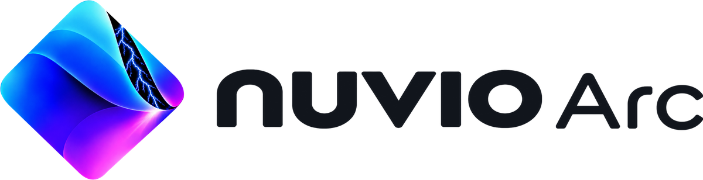
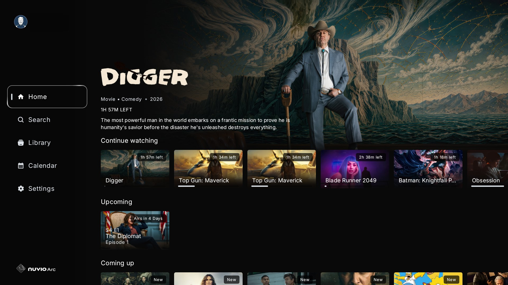
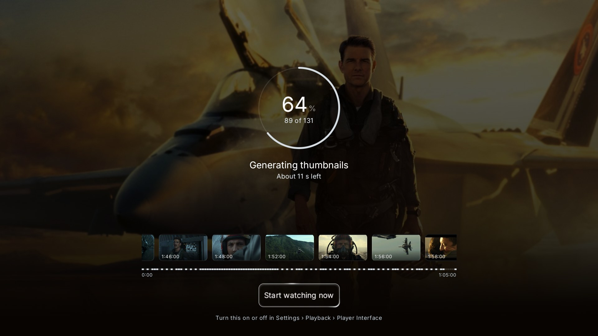
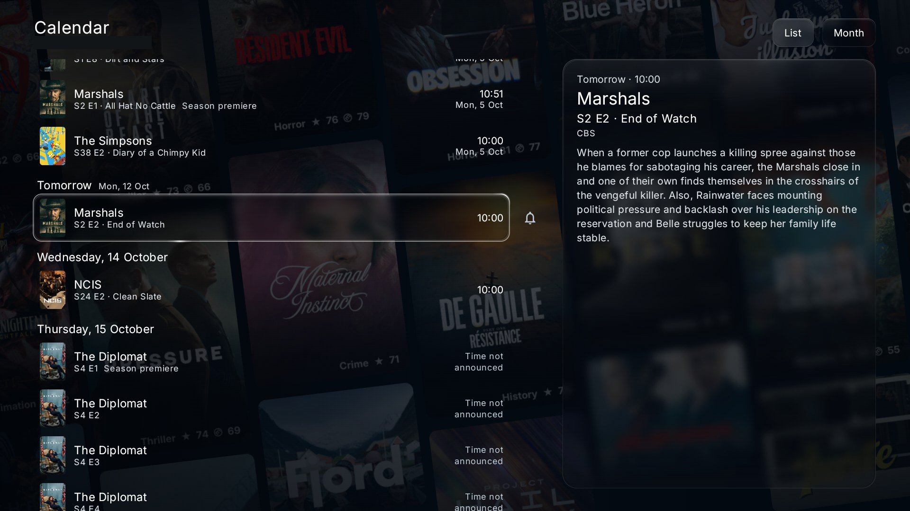
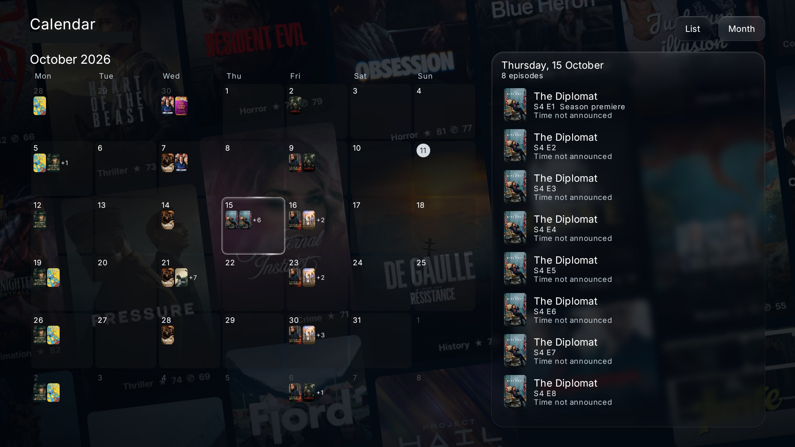
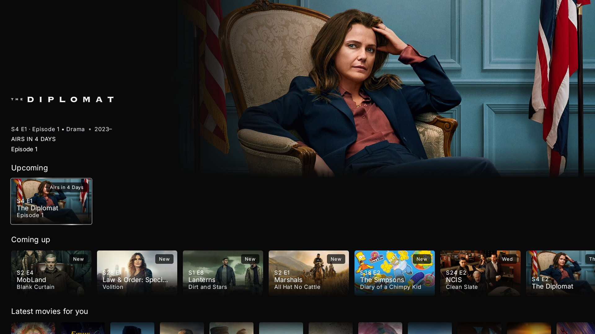
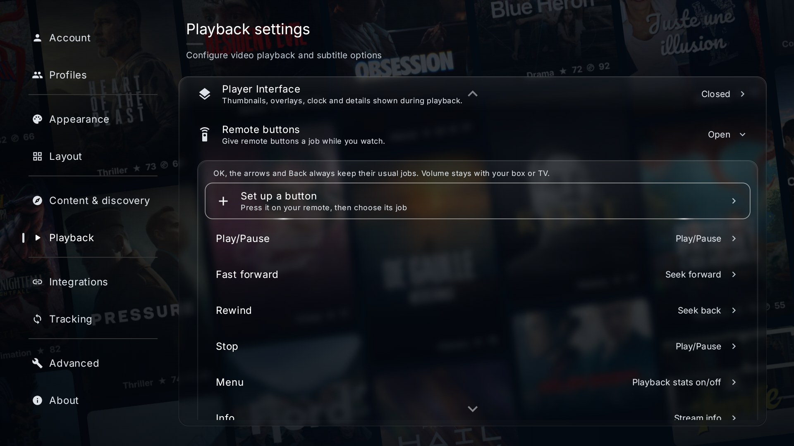
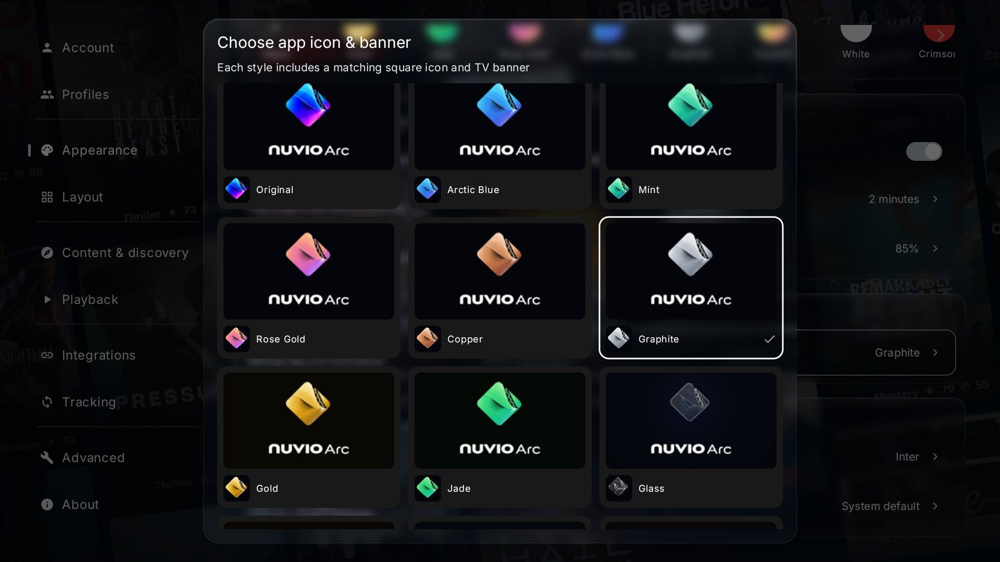
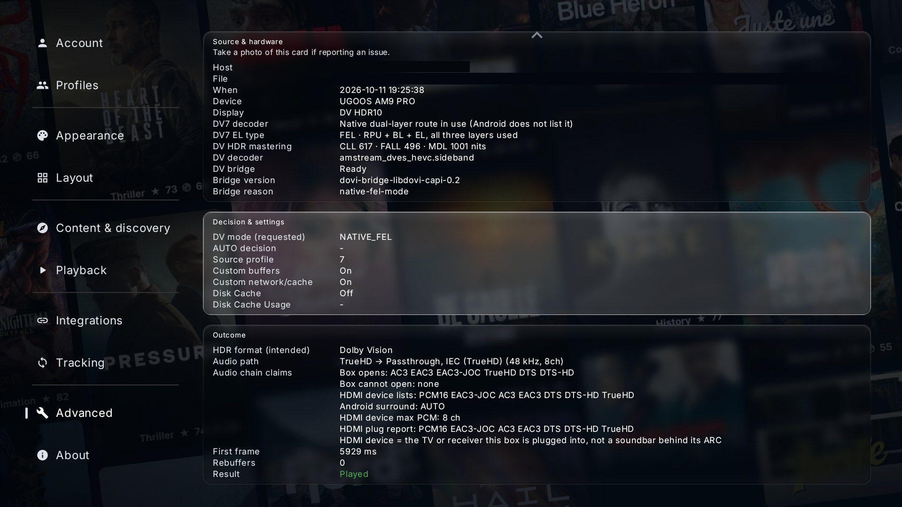

  <picture>
    <source media="(prefers-color-scheme: dark)" srcset=".github/branding/nuvio-arc-logo-on-dark.png">
    
  </picture>

## About

**Nuvio Arc** is my hobby fork of [NuvioTV](https://github.com/NuvioMedia/NuvioTV) -- an experimental build where I try
out new ideas on top of the official app. It isn't a competitor to Nuvio and it isn't meant to replace it. Think of it
as a test bench: some ideas work out, some don't, and the ones that are solid, well tested and good for everyone may
end up suggested for the official app.

I also contribute to the official app myself. When a fix or feature here is thoroughly tested and fits what Nuvio is
aiming for, I offer it upstream. Most of what's in Nuvio Arc stays here, because it's built for a narrower audience.

**Who it's for.** The official Nuvio app is designed for everyone, on every kind of device. Nuvio Arc runs on the
same boxes, from a Fire TV Stick up, and is for people who like Nuvio, want to stay in the Nuvio ecosystem, and are
happy to try new and largely untested features. A lot of the work goes into speed and quality for high-bitrate 4K
remuxes and lossless audio (100 GB+ remuxes, TrueHD / DTS-HD MA / Atmos / DTS:X passthrough, Dolby Vision), so it
shines on stronger boxes, but everyday use on regular boxes works too.

**Expect rough edges.** New features land here before they are proven, so things can break between releases. Some
features (for example 4K thumbnails) do more work on the box and write to its storage, and the app tells you where a
feature is heavy. If you want the dependable everyday app, use the official Nuvio.

## Support, issues and contact

Nuvio Arc is a one-person project, so there's no Discord and no support team. You're welcome to:

- **Report a bug or suggest an idea** in this repo's [Issues](https://github.com/ysosrs123/NuvioTV-Fork/issues). I read
  them when I can, but it's a hobby, so no promises on replies or fixes. Please include your box, the Nuvio Arc version
  (Settings > About) and what you were playing.
- **Chat with other users** at [r/NuvioForks](https://www.reddit.com/r/NuvioForks/).

Nuvio Arc is not affiliated with or endorsed by the NuvioTV project. **Please don't report problems from this build to
the official Nuvio GitHub or the official Nuvio Discord** -- they can't help with changes they didn't make, and it
takes their time away from the official app.

## Supporting Nuvio

Nuvio Arc is built on Nuvio. If you enjoy it, support the Nuvio team at [nuvio.tv/support](https://nuvio.tv/support).
Every supporter membership and donation in the app goes straight to the official Nuvio team -- none of it comes to me.

---

## What this fork adds

Optimisation and playback-quality work, most of it aimed at high-bitrate remux and lossless audio,
plus a few features I've always wanted in a TV player. The short version: streams start faster,
buffer deeper, stall less, and you can *see* that your device is genuinely delivering lossless audio
and the right HDR -- without needing to be the kind of person who tunes buffer settings for fun.

- **Seek thumbnails made by the app itself** -- hold left or right and a strip of pictures shows
  exactly where you will land, from an old AVI to a 4K Dolby Vision remux. On by default. A new
  thumbnail every 10 seconds, sharp enough to read the scene, ready straight away for anything
  you've played before, and carried over to another release of the same film. When your Jellyfin,
  Emby or Silo server has made its own thumbnails, the player uses those. Turn on **Thumbnails from a
  copy** and a 4K film gets its thumbnails from a 1080p copy in your sources, about five times less to
  download, so even a Fire TV Stick can make them while the film plays. No third-party service, no API
  key, nothing uploaded.
- **Your own media server** -- Jellyfin, Emby and Silo libraries on Home, in Search, in the Library
  and as a source on any title the server has, with direct play, second addresses and self-signed
  certificates. Give each server your own name, show or hide the server logos, and sign in to Silo
  with the same address you open it with in the browser.
  Silo also has its own sign-in now: a code and a QR on the TV, sign in on your
  phone, pick your Silo profile on screen, and your Silo Home rows show up on Nuvio Home.
- **Watch party** -- watch the same title with friends in other homes, in sync, with a six-character
  code or an invite. No account and no server of ours; bitstream audio is never sped up or slowed
  down to catch up. Every party runs on a long random key and only the host runs the room.
  Everyone in a party needs Nuvio Arc 1.1.0-nt.5 or newer.
- **Calendar and new-episode reminders** -- a new page in the menu that shows when the next episodes
  of your shows come out, in your own time zone, plus cinema and streaming dates for films on your
  lists. Ring the bell on a show and a card on Home tells you when a new episode is out, with Watch
  now straight to its sources. An optional **Coming up** row on Home shows what's just out and
  what's next.
- **Remote buttons** -- give any button on your remote a job while you watch: stats on or off,
  subtitles on or off, next audio track, skip 5 minutes, start over, sources and plenty more. Works
  with colour buttons, number pads, your TV's own remote over HDMI and buttons set up in tvQuickActions
  or Button Mapper, and comes with a starting setup that just works on the Fire TV remote. The Search
  button on your remote opens Search.
- **Lossless audio you can trust** -- a surround engine that packs TrueHD, DTS-HD MA and DTS:X for
  HDMI itself, with an **Auto surround** mode that picks the formats from what your TV and receiver
  report. Or set it yourself with per-format passthrough switches (Dolby Digital, DD+, TrueHD, DTS,
  DTS-HD) phrased as questions about your receiver, following Kodi's audio settings: switch off what
  your gear can't decode and Nuvio decodes just those in the app, with its own decoder, because some
  boxes ship a vendor DTS decoder that quietly folds 5.1 to stereo. It resists mid-film renegotiation
  dropping you to lossy without telling you, comes back after the TV switches input, plays DTS Express
  commentary tracks, and picks the lossless track so you don't start every film in the wrong audio.
- **Native Dolby Vision Profile 7, FEL and MEL** -- the full dual-layer signal decoded inside
  Nuvio on Android, enhancement layer included, the way a disc player does it. For now this needs a
  Ugoos AM9 Pro on Android 14 running my custom FEL kernel, plus a Dolby Vision display. Stock
  firmware and other boxes can't do it yet, so there the mode simply behaves like Auto.
- **Dolby Vision on more TVs** -- app-side Profile 7 and Profile 5 -> 8.1 conversion via libdovi with
  no per-frame stutter, correct enhancement-layer handling for single-track remuxes, and **Auto**
  converting Profile 7 on every Dolby Vision TV, including TVs with Android built in whose decoder
  claims it can play Profile 7 and then shows nothing.
- **Better streams picked for you, automatically** -- source filtering and sorting re-baselined
  around TRaSH-guides-aligned release-group quality tiers, so the best-quality trustworthy release
  floats to the top and auto-play grabs the right one without you reading twenty filenames.
  **Sort sources: Best quality first** puts the best link at the top of the source list too, by the
  same rules. Safe to experiment: one tap resets to the recommended baseline, another shows everything
  unfiltered while keeping best-first ordering, and **Quality rules** has its own page under Playback.
- **Smoother browsing, even on a Fire TV Stick** -- Home no longer rebuilds itself as you move from
  poster to poster, the focus ring glides calmly along a row, and Up and Down keep your place across
  rows. Settings, Library and Search paint their poster wall or artwork background once and reuse it:
  on a Fire TV Stick 4K Max, scrolling Settings with the Posters background and Glass went from 2 % to
  96 % of frames on time.
- **Device settings assessment -- your settings, tuned for *your* hardware in one press.** Stop
  guessing what connection count, buffer size or Dolby Vision mode your box wants: the assessment
  measures your link against the last thing you actually played, reads what your device and
  display genuinely support, and lays out recommended settings with the reasoning next to every
  one -- what was measured, what was calculated from your hardware, what's a personal trade-off
  (pick a buffer profile; it'll suggest one based on how steady your connection looked), and what
  it can't honestly know so won't touch. Like the answers? Apply them all in one press. Change
  your mind? Revert restores every previous value, even after a restart. You stay in charge; it
  just does the homework.
- **A speed test that tells you what to do about it** -- goes further than the official app's speed
  test: an adaptive sweep of connection and chunk-size combinations against the *actual* stream you
  last played, over the same path playback uses. It finds the cheapest configuration that comfortably
  sustains the title and says so in plain terms -- and on memory-tight boxes it's smart enough to
  prefer a config that leaves room for a deeper playback buffer, telling you the trade in MB and
  seconds. Slow source or buffering bug? Now you can tell them apart.
- **Stats-for-nerds overlay -- proof, not vibes.** A fuller version of the official app's stats
  overlay, built for high-bitrate/lossless content: measured video bitrate, the audio codec by name
  with its measured passthrough bitrate, whether bitstream is *genuinely* reaching your AVR, Dolby
  Vision details (which layers made it to the picture, CLL/FALL), live network throughput and buffer
  health, dropped *and* skipped frames, the negotiated audio path, SoC stats and how far your box is
  from its own temperature limit so you know when it's being throttled, audio-clock jitter and underrun
  cross-checks. When it says TrueHD Atmos is hitting the sink, it measured it. The assessment
  configures; this overlay verifies.
- **Playback that holds up** --
  - *Fewer stalls, less wasted bandwidth:* upstream's parallel downloading kept too little data
    queued ahead of playback and threw away chunks it had already paid to download (measured ~47% of
    transfer wasted on a 4K remux). This fork keeps the pipeline properly fed and stops the
    re-downloading, roughly halving the debrid data burned per title. Buffers are sized from the
    memory your box really has, so a 2 GB box no longer chokes on its own buffer.
  - *Faster stream start:* pressing play opens the connection at the press. With **Search sources
    before Play** on (off by default) the app also searches and ranks sources while you browse.
  - *A dead link is not a dead end:* when a source fails at the start, the player moves on to the next
    ready one by itself, on ExoPlayer and MPV, and a dead server is noticed within seconds.
  - *Judder-free frame rates:* precise 23.976-vs-24 matching, 120 Hz for films on screens without
    24 Hz, and frames kept evenly spaced on the TV's refresh ticks.
  - *Old formats that play properly:* AVI, XviD, DivX, VC-1 and WMV, with frame rate matching, and
    non-faststart MP4s that seek without stalling.
  - *Faster AV1 on boxes without an AV1 chip,* decoded with dav1d.
- **Trailers that start quickly** -- with Trailer source set to IMDb, the trailer is found in under a
  second, plays at the best resolution IMDb has (up to 4K) and starts after a short buffer.
- **The Nuvio Arc look** -- a logo that takes its colours from your theme, an intro where the Arc
  lights up, with sound in 5.1 where your system has it, 16 launcher icons, a new Copper theme, Glass
  that looks like glass and a new main menu in Nuvio V2.
- **Watched titles on Home: Show, Dim or Hide** -- fade or hide what you've already watched, without
  touching Continue Watching, Library or Search.
- **Player buttons you can arrange** -- show, hide and reorder the player controls per profile.
- **Support the Nuvio team, built in** -- a button on the start screen and in Settings shows what a
  Nuvio Supporter membership gives you and a QR code to nuvio.tv/support, and tells supporters their
  tier once they sign in.
- **The whole fork in 37 languages.**
- **Lighter, faster build** -- unused engine components stripped out, so the app itself is smaller
  and snappier (see *What's been removed*).

## Screenshots (Nuvio V2)

https://github.com/user-attachments/assets/b2063feb-7c4a-4fa1-924d-63686184f5dd

**Native Dolby Vision Profile 7 FEL on the Ugoos AM9 Pro** -- the stats overlay showing "Profile 7.6 FEL - RPU + BL + EL" on the native route.

For now this needs a Ugoos AM9 Pro on Android 14 running my custom FEL kernel, plus a Dolby Vision display. Stock firmware and other boxes can't do it yet, so there the mode simply behaves like Auto.

**Seek thumbnails** -- the strip and the framed picture while holding left or right.

The "Generating thumbnails" screen -- the thumbnails being made before play, the strip filling in as they come. Start watching now skips the wait.

**Calendar** -- what just aired and what's coming, in your own time zone.

**Remote buttons** -- give any button a job in the player.

**Watch party** -- the party page with the code, the phone QR codes and the member list.

**Your own media server** -- Jellyfin, Emby and Silo rows on Home, and a server stream in the source list.

**The Nuvio Arc look** -- the launcher icons and themes.

**Player buttons** -- the editor with its live preview.

**Surround sound** -- Surround Format on Auto, with the per-format switches.

## Stats for Nerds Overlay -

**Source & hardware** -- Settings > Advanced after a Profile 7 FEL title on the AM9, with the DV7 decoder and DV7 EL type rows.

## Revised Last Played Stream Speed Test:

## Device Assessment:

## Per-Format Audio Passthrough Switches:

---

## What's been removed

- **IAMF** and **MPEG-H** audio decoder components, and an unused UI component -- dropped to slim
  the build. No user-facing loss.
- **Android TV channel / preview-program sync** -- not used on this fork's target setup.
- **The upstream update feed** -- in-app updates come from this fork's own releases only.
- **The "Choose your Nuvio experience" screen on first start** -- everyone gets the full settings
  straight away. Essential is still there under Settings > Advanced > Switch to Essential.
- **The Report buttons** in the player and under Settings > Advanced -- they could never send anything
  from this build. Please use this repo's Issues instead (see *Support, issues and contact*).

**Not removed** (sometimes assumed otherwise): all **40 languages** (the fork's own text is translated
into 37 of them), the Classic, Grid and Modern **Home layouts**, the **add-on manager**, and
**subtitle add-on support** are intact.

---

## Target hardware

Primary/validated target is the **Amlogic S905X4 / 4GB RAM, Amlogic S905X5M / 2GB RAM class (armeabi-v7a) and AmLogic S905X5-J / 4GB RAM (arm64-v8a)**, tested on a Homatics Box R
4K Plus, Xiaomi Box S 3rd Gen, Fire TV Stick 4K Max and Ugoos AM9 Pro in a Samsung HW-Q800F -> LG C9 eARC chain. Other devices (Nvidia Shield, Prism+, Xiaomi) have been
community-tested.

---

## Licence

This is a modified version of [NuvioTV](https://github.com/NuvioMedia/NuvioTV), changed by ysosrs123
from July 2026 onwards. Every change is in this repository's history on top of the official release
it builds on (currently 1.1.0-beta.5). It is licensed under the
[GNU General Public License v3.0](./LICENSE), the same as NuvioTV. All upstream copyright notices,
licence headers and author attributions are kept. Full credit to the NuvioTV maintainers and contributors.

Parts from other projects keep their own licences:
- TrueHD MAT packing and the downmix path: ported from Kodi (GPL-2.0-or-later), see
  `ffmpeg-decoder-downmix/NOTICE.md`.
- Audio passthrough engine: official pull request 3107 by halibiram, with ram130. Media servers:
  official pull request 3728 by tapframe.
- FFmpeg (LGPL-2.1-or-later): audio decoder built from FFmpeg 7.0.2, recipe in
  `.github/workflows/build-ffmpeg-decoder.yml`; headers only under `app/src/main/cpp/third_party/`.
- dav1d by VideoLAN and the dav1d authors (BSD-2-Clause) for software AV1 decoding, with
  cpu_features by Google (Apache-2.0).
- libdovi by quietvoid (MIT). Matroska extractor files from AndroidX Media3 (Apache-2.0), changed.
- Release group lists from TRaSH Guides (MIT).
- Fonts Atkinson Hyperlegible Next and Source Sans 3 (SIL Open Font License 1.1, texts in
  `app/src/main/assets/licenses/`).
- Watch party avatars: made with DiceBear and Twemoji, under CC BY 4.0, CC0 1.0 and the Bottts terms.
  They are credited in the app under Settings > About > Licenses & attribution and are not covered by the GPL.
- Calendar episode times come from TVmaze's schedule service, credited in the app under
  Settings > About > Licenses & attribution.
- Other service logos and names belong to their owners and only show which service the app connects to.
- Prebuilt libraries that come unchanged from the official app are covered by the official project's
  sources and notices.

This fork is not affiliated with or endorsed by the NuvioTV project or any of the services named.
